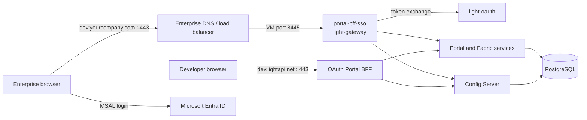
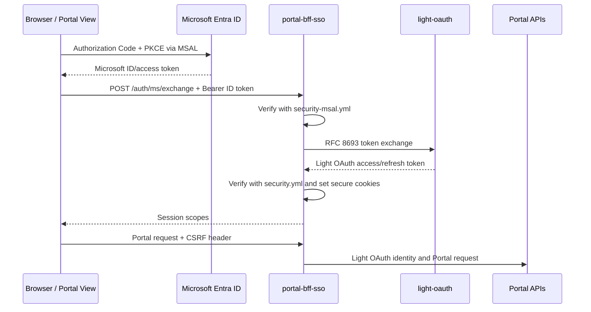
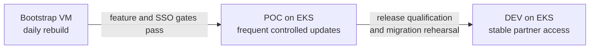

# portal-config-bootstrap

Linux VM bootstrap deployment for the Light Portal platform, its supporting
databases, Light Fabric services, and an enterprise Microsoft Entra SSO Portal
BFF based on `msal-exchange`.

The canonical service, environment-variable, secret, port, dependency, and SSO
runtime reference is the
[portal-config-bootstrap operations guide](https://doc.lightapi.net/operations/docker-compose/portal-config-bootstrap.html).

This repository is intentionally separate from `portal-config-dev`:

- `portal-config-dev` remains the public OAuth 2.0 authorization-code reference.
- this repository can evolve enterprise DNS, certificates, secrets, SSO, data
  preservation, and AI-assisted operations without destabilizing public dev.
- the committed `portal-config-dev` stack is retained as the baseline; the
  enterprise differences live in `docker-compose.bootstrap.yml` and
  `portal-bff-sso/`.

The initial baseline was taken from committed `portal-config-dev` commit
`d597470ef0ae6ddf883d2fc88622cf1eb5431cf2`; see
[`UPSTREAM_BASELINE.md`](UPSTREAM_BASELINE.md). Local uncommitted changes in the
source checkout were not copied.

## Topology



The VM exposes the existing OAuth BFF on port `443` and the SSO BFF on port
`8445` by default. Enterprise DNS/load-balancing should terminate or forward
`https://dev.yourcompany.com:443` to the SSO listener. This avoids putting two
containers on the same host port and mirrors the host-routing boundary that
will later exist in EKS.

## Why a second BFF

Both BFFs use the same `light-gateway` image, but they are separate runtime
identities. The SSO BFF has its own:

- `(host, serviceId, envTag)` Config Server snapshot;
- `msal-exchange` handler chain and Microsoft token verifier;
- token-exchange confidential client;
- customer TLS certificate and host routing;
- config-cache volume; and
- Shared signed Portal View package configured for Entra SSO at runtime.

This prevents redirect URIs, cookies, handlers, and client credentials from
being switched globally when testing OAuth and SSO side by side.

## Prerequisites

- Docker Engine with Compose v2
- `openssl`, Python 3, `curl`, and `unzip`
- Microsoft Entra SPA registration with the exact redirect URI
- Light OAuth client authorized for token exchange
- Portal bootstrap token scoped to the SSO BFF Config Server identity
- enterprise certificate for `dev.yourcompany.com` before shared use

## First-time setup

1. Create the private environment file:

   ```bash
   cp .env.bootstrap.example .env.bootstrap
   ```

   Replace every `replace-*` value. Do not commit this file.

2. Configure and prepare the packaged SSO Portal View:

   ```bash
   cp portal-bff-sso/config/portal-config.entra-sso.example.json portal-bff-sso/config/portal-config.json
   ```

   Edit `portal-config.json` with the registered Entra tenant/client UUIDs and
   redirect/logout URLs. Keep tenant/client values consistent with `.env.bootstrap`.
   Provision approved public release keys in
   `portal-bff-sso/config/portal-view-release-keys/<keyId>.pem`, then run:

   ```bash
   python3 -B scripts/portal-view-release.py --service portal-bff-sso prepare
   ```

   This downloads and verifies the shared package and validates the exact SSO
   image offline. No customer-specific build is needed. On a fresh setup, publish the signed
   SPA snapshot settings described below **before first use**: preparation does
   not populate the legacy `portal-bff-sso/lightapi/dist` directory.

3. Install enterprise TLS files as `portal-bff-sso/tls/ca.pem`, `cert.pem`, and
   `key.pem`. For single-user VM testing only, generate a self-signed set:

   ```bash
   ./scripts/generate-bootstrap-tls.sh
   ```

4. Create and publish the dedicated Config Server snapshot described in
   [`portal-bff-sso/config-server/README.md`](portal-bff-sso/config-server/README.md).
   Clone the working Portal BFF snapshot, preserve all Portal routes, and change
   only the customer host and authentication chain.

5. Validate the repository and start the stack:

   ```bash
   ./scripts/validate-bootstrap.sh
   ./scripts/restart-bootstrap-stack.sh
   ```

For an initial database recreation from the current CDN baseline:

```bash
./scripts/restart-bootstrap-stack.sh --recreate-database
```

The recreation command verifies the signed `events.zip` with the pinned
Ed25519 public key in `release-keys/<keyId>.pem` before extracting `events.json`
or stopping the existing database. The repository ships the current release
key. A controlled deployment may set `EVENT_BUNDLE_KEY_DIR` to another
independently provisioned trust directory. Never download the trusted key from
the same CDN location as the bundle it verifies. The extracted editable JSON
records the verified archive digest in
`data/events.json.source-bundle.sha256`; a later import fails if the adjacent
archive no longer matches that marker.

The inherited recreation path moves the old PostgreSQL data directory to a
timestamped backup before rebuilding it. Until the host-scoped export/import
workflow below is automated and qualified, do not schedule this command on a
VM containing customer-created entities.

## MSAL exchange flow



`security-msal.yml` validates the incoming Microsoft token. The normal
`security.yml` remains mandatory because it validates the Light OAuth token
returned by the exchange and used for Portal authorization and custom claims.

## Daily bootstrap lifecycle

The target lifecycle is documented in
[`docs/bootstrap-data-lifecycle.md`](docs/bootstrap-data-lifecycle.md). Its
central rule is: export only the customer host from the global export, verify
the artifact, rebuild global and `dev.lightapi.net` from the published
`events.json`, then import the customer host and wait for projections before
declaring the stack ready.

The repository currently provides the recoverable baseline recreation and the
SSO deployment scaffold. Host-scoped export/import automation is deliberately
not faked: it must be wired to the qualified Portal export contract and tested
with aggregate-version, dependency, and projection-readiness checks before a
daily timer is enabled.

## Environment promotion



- **Bootstrap** is disposable and optimized for integration feedback.
- **POC** is the first official EKS deployment and changes through a controlled
  promotion, not an automatic daily rebuild.
- **DEV** is partner-facing. Every release requires forward data migration,
  rollback evidence, and retained customer data.

## Repository layout

| Path | Purpose |
| --- | --- |
| `docker-compose.yml` | Committed public-dev baseline stack |
| `docker-compose.bootstrap.yml` | Bootstrap overlay and dedicated SSO BFF |
| `.env.bootstrap.example` | Non-secret environment contract |
| `portal-bff-sso/config/` | Local startup identity and runtime overrides |
| `portal-bff-sso/config-server/` | Reviewable MSAL snapshot source/fragments |
| `portal-bff-sso/lightapi/dist/` | Ignored customer-specific SPA build |
| `portal-bff-sso/tls/` | Ignored enterprise or local-development TLS |
| `scripts/` | Build, validation, database, and stack lifecycle tooling |

## Security boundaries

- Never commit `.env.bootstrap`, private keys, tokens, client secrets, exported
  customer data, or AI session transcripts.
- The copied public-dev baseline still contains development-only database
  passwords, certificates, and bootstrap token defaults. Treat these as local
  compatibility fixtures and replace them before any shared enterprise use.
- Use an enterprise secret manager for POC/DEV; the local env file is a VM
  bootstrap convenience only.
- Give AI tooling read-only Kubernetes, source, log, and database access by
  default. Deployment or database writes require an approved workflow with an
  audit trail.
- Replace self-signed certificates and disabled hostname verification before
  promoting beyond a single-user Bootstrap VM.

## Private Host deltas

The signed baseline owns the three canonical Hosts; release deltas remain
available for older pinned baselines. Keep customer-specific Host exports outside Git in
`data/private-event-deltas`; see [the private delta guide](events/PRIVATE_INSTANCE_DELTAS.md).

## Packaged Portal services

Command/query JARs are included in the hybrid images. Set
`PORTAL_HYBRID_COMMAND_IMAGE` and `PORTAL_HYBRID_QUERY_IMAGE` to packaged image
references in the deployment environment file. Existing 2.2.1 wrapper images
that depended on host JARs are unsuitable. Compose requires both selections and
mounts configuration directories only; there are no host service-JAR folders.
Asset synchronization retains UI assets and does not download hybrid ZIPs.

Bootstrap acquires a missing `docker-images.env` automatically before rendering
Compose configuration. This applies to direct Portal View `prepare`, the default
signed `sync-assets.sh` flow, `validate-bootstrap.sh`, and `restart-bootstrap-stack.sh`.
The publisher generates this file; it is intentionally excluded from Git.

Preparation downloads image selections from the same resolved enclosing release
as the signed UI: `<release-base>/<version>/docker-images.env`. Startup and
validation resolve `LIGHT_PORTAL_VERSION` (default `latest`) through the same
release pointer when the file is absent. The download uses the configured release
base and User-Agent, accepts only image-reference assignments with both packaged
hybrid selections, and publishes the complete file atomically. Failed or malformed
downloads stop before Compose, image pulls, or container operations. These checks
validate image metadata syntax; they do not authenticate it as a signed artifact.

An existing regular file is retained byte for byte, so owner-provisioned image
pins also work offline. Compose loads the release file before the private
`LIGHT_PORTAL_ENV_FILE` and `.env.bootstrap`; existing override precedence is kept.
To acquire only the missing image metadata without running Compose:

```bash
python3 -B scripts/portal-view-release.py image-env
```

For direct Compose use, pass the selected environment file with `--env-file`.
Use the existing deployment entry point for the complete environment and startup
ordering; updating source files does not restart already-created containers.

### Podman CLI adapter

On Podman hosts, select the versioned adapter from this checkout before running
bootstrap scripts. This replaces a minimal `docker` shim that only forwards
arguments and loses earlier environment files with older `podman-compose`.

```bash
export PATH="$PWD/scripts/podman-compat:$HOME/.local/bin:$PATH"
hash -r
command -v docker
python3 -B scripts/portal-view-release.py --service portal-bff-sso prepare
```

The adapter forwards engine commands to `podman` and Compose commands to
`podman-compose`. It combines ordered global `--env-file` inputs into one mode-0600
temporary file, preserving later values and exported-variable precedence, and
removes the temporary file after the provider exits. `config --quiet` suppresses
rendered credentials while preserving provider errors and exit status. Service
command arguments and stdin are passed through unchanged.

This adapter is for the simple literal `KEY=value` files used by the bootstrap
workflow. Do not use cross-file interpolation or multiline dotenv values with
it; those require a Compose provider qualified for native ordered env-file
semantics. The release runner already falls back to YAML when the provider
does not implement `config --format json`. Reapply the PATH selection in each
deployment shell (or in its existing startup configuration).

## Signed Portal View packages

Portal View is built once by the release publisher. Deployment configuration lives
in `config/portal-config.json`; changing customer authentication or URLs does not
require Node.js, npm, a Portal View checkout, or rebuilding the SPA.

Release downloads identify as `portal-view-release/1.0`. Set
`PORTAL_VIEW_USER_AGENT` to printable ASCII text to override it; an unset or
empty value uses the default. Invalid nonempty values are refused before remote
staging creates directories, and one transport serves each stage batch.
Injected preparation transports retain their headers. Signature verification
and gateway readback requests are unchanged.

Release downloads use Python's standard proxy configuration, including
`https_proxy` / `HTTPS_PROXY` and `no_proxy` / `NO_PROXY`. Set the approved proxy
in the same shell that invokes the scripts when direct Internet access is
unavailable. The release pointer, signed metadata/package members, and missing
`docker-images.env` acquisition use this routing. Redirects remain refused and
TLS certificate verification remains enabled. Gateway serving readback keeps
its separate direct connection and configured CA trust; it does not use the
release-download proxy.

Reading the gateway image and published port works with Docker Compose and with
podman-compose, which has no `config --format json` and may run without PyYAML:
when the JSON form is refused, the runner reads the YAML `config` output with a
small built-in parser limited to the `light-gateway` image and `ports`.

Maintainers synchronize download helpers and contract test support from
`portal-config-loc` using its `scripts/sync-portal-view-downloads.py --check`
(or `--write` after a canonical change) with sibling checkouts present. The
release test suite verifies local helpers and fixture against the source consistency
snapshot; its CI workflow runs from a single checkout on Python 3.9, 3.12, 3.13, and 3.14,
including hostile proxy settings. It runs on every pull request and master push
so changes to Compose, installer, and asset-sync inputs also run the tests.
The snapshot records a canonical commit for audit and accidental-drift checks;
it is not independent verification when source and snapshot change together.

The default selection is `latest`. Preparation reads
`https://cdn.networknt.com/light-portal/releases/latest/portal-view/release-pointer.env`
once and resolves a versioned release directory. It then verifies the signed
archive using independently provisioned public Ed25519 keys. The local release
state records the artifact version and manifest digest. A moving CDN pointer never
changes an already running service.

Set `LIGHT_PORTAL_VERSION=<enclosing-release>` to pin a release. Override
`LIGHT_PORTAL_RELEASE_BASE_URL` only for another CDN/release root; daily releases
require no repository URL edits. Metadata, pointer, signature, configuration and
image-validation errors (including HTTP 404) stop preparation. Do not obtain
trust keys from the same download location as the package.

Provision public keys at
`light-gateway-rust/config/portal-view-release-keys/<keyId>.pem` and customize
`light-gateway-rust/config/portal-config.json` before preparation. Dev ships an
OAuth configuration; bootstrap includes OAuth and Entra example JSON files.
Existing configuration bytes are preserved.

```sh
./scripts/sync-assets.sh
# Optional reproducible selection:
LIGHT_PORTAL_VERSION='<enclosing-release>' ./scripts/sync-assets.sh
# Deliberate legacy compatibility only:
./scripts/sync-assets.sh --legacy-only
```

Normal sync retains the legacy UI/sign-in assets and prepares the signed Portal
View package by default (`--stage-signed` remains a compatible explicit spelling).
Legacy refresh replaces only `lightapi/dist`; signed releases, current, state,
transition journal, lock, and unrelated parent contents are preserved.

Preparation inspects the exact effective Compose gateway image, pulls it only if
absent, and validates offline with `--network none --pull never`. It may therefore
download an image. Failed acquisition leaves a verified staged candidate and
preserves current/state/journal. First preparation sets the signed pointer only;
a subsequent candidate is staged and validated while the active version stays
unchanged. The command prints the explicit activation command. Repeats validate
offline without serving readback. Interrupted staging directories/journals are
preserved for explicit owner recovery.

Serving cutover remains an explicit Portal UI/Config Server snapshot action:
set the Portal virtual-host base to `/lightapi/current/dist` and enable its `spa`
configuration with `runtimeConfig: /config/portal-config.json`,
`releaseManifest: /lightapi/current/release-manifest.json`,
`releaseKeyDir: /config/portal-view-release-keys`, `index: index.html`, and
`basePlaceholder: __PORTAL_BASE_HREF__`. Publish the snapshot before explicit
recreation. Preserve the previous snapshot for first-cutover rollback.

```sh
python3 -B scripts/portal-view-release.py status
python3 -B scripts/portal-view-release.py recreate --expect-legacy
# After the explicit snapshot cutover:
python3 -B scripts/portal-view-release.py recreate
# Subsequent upgrades, after preparation:
python3 -B scripts/portal-view-release.py activate --version '<artifact-version>'
python3 -B scripts/portal-view-release.py rollback
python3 -B scripts/portal-view-release.py recover
```

Lifecycle commands require serving digest readback; use `--readback-url` on
activate/recreate/rollback/recover if external ingress differs from the default.
No asset sync automatically recreates containers, cuts over serving, switches an
active version, recovers, or prunes releases. Python 3 and OpenSSL are required.

### Enterprise SSO service

The SSO service has independent assets/state under `portal-bff-sso/lightapi`,
runtime configuration under `portal-bff-sso/config/portal-config.json`, and trust
keys under `portal-bff-sso/config/portal-view-release-keys`. Normal primary-gateway
sync does not alter this separate service. Prepare/update it explicitly:

```sh
python3 -B scripts/portal-view-release.py --service portal-bff-sso prepare
python3 -B scripts/portal-view-release.py --service portal-bff-sso status
# After publishing the signed SPA settings in the customer's SSO snapshot:
python3 -B scripts/portal-view-release.py --service portal-bff-sso recreate
# Subsequent explicitly approved update:
python3 -B scripts/portal-view-release.py --service portal-bff-sso activate --version '<artifact-version>'
```

The same selector supports stage, rollback, and recover. It validates/recreates
only `portal-bff-sso`, using its effective image and published port. Default
readback uses `CUSTOMER_PORTAL_HOST` from the environment/bootstrap dotenv file.
Use an explicit `--readback-url` if ingress differs. The old
`scripts/build-portal-view-sso.sh` command is a compatibility wrapper for SSO
package preparation; it no longer builds source or reads Vite variables.

### Rollout prerequisites

Hold consumer merges/releases until the approved Portal View public key is
committed in the deployment trust directories and the first complete versioned
release plus latest pointer is published and verified. The enrolled public key is `portal-view-release-2026-10.pem`; the private
key stays in the publisher checkout. First publication is still pending. Coordinate key enrollment and
publication with the release owner; never obtain the trust anchor from the CDN.
